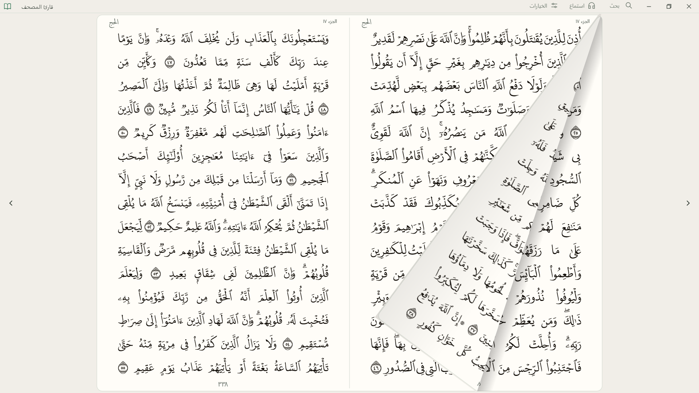

<div align="center">


# Quran Mushaf Reader

### قارئ المصحف

**The Mushaf, the way a Mushaf should look on your PC.**<br>
Free, open source, and small enough to feel like a book rather than a browser.

مصحف رقمي مجاني ومفتوح المصدر لنظام ويندوز

[**Download for Windows**](https://github.com/Thrpro/Quran-reader/releases) · [Features](#what-you-get) · [Quran integrity](#the-quran-text-is-never-touched) · [Build from source](#build-from-source)


</div>

<!-- TODO before publishing: replace this still with docs/page-turn.gif, recorded from the release build. It will sell the app better than any sentence on this page. -->



## Why this exists

Most Quran apps for the desktop feel like an afterthought. Some are hundreds of megabytes, arrive as an archive you have to unpack, hide things behind confusing menus, or leave the page small in the middle of a large screen.

This one has a simple goal: **open it and read.** The pages fill your screen, the script stays sharp at any window size, and everything else stays out of the way until you ask for it.

| | |
|---|---|
| **The page comes first** | No permanent toolbars or bottom bar. A slim title bar, then the Mushaf at the largest size your window allows. |
| **Crisp at any size** | Each page is drawn for your exact window and display scale using [Digital Khatt](https://digitalkhatt.org), not scaled up from an image. |
| **Turns like paper** | Drag a page from its corner or tap an arrow key. Turns run on your GPU, at up to 144 Hz on the display tested. |
| **Light on your PC** | About 90 MB on disk, and about 230 MiB of memory after 60 page turns. Details [below](#small-and-light-measured). |
| **Yours to inspect** | Open source, no account, no ads, and every bundled Quran file is listed with its SHA-256 hash. |

## What you get

<table>
<tr>
<td width="50%"></td>
<td width="50%"></td>
</tr>
</table>

**Read**
- All 604 Mushaf pages, as a two-page spread or a single page
- Light, dark and sepia themes
- Optional contextual lettering from Digital Khatt
- Page turns you can drag from the corner, or trigger with the arrow keys
- Full screen with <kbd>F11</kbd>, and bookmarks that are saved between sessions

**Find**
- Search by text, surah, page, juz, hizb or quarter-hizb
- Arabic and Persian page digits are understood

**Understand**
- Tafsir Al-Mukhtasar and Tafsir Al-Saadi in Arabic, Saheeh International in English, all bundled for offline use
- Tafsir opens in its own column, so it never covers the Quran text
- Right-click any ayah for study, listening and bookmarks

**Listen**
- Listen from any ayah to the end of its surah, or to a single ayah
- A choice of reciters, adjustable speed and volume, and seeking
- The current ayah is highlighted on the page as it is recited

**In your language**
- A full Arabic or English interface, and the layout follows your reading direction

## Small and light, measured

| | Native (this version) | Previous WebView2 version |
|---|---:|---:|
| Application and Quran resources on disk | **about 87 MB** | about 61 MB, plus the shared WebView2 runtime |
| Memory at idle after page turns, standard text | **230 MiB** | 506 MiB |
| Memory at idle after page turns, contextual lettering | **311 MiB** | 713 MiB |
| CPU while idle | **under 0.1%** | not measured |

<details>
<summary>How these were measured</summary>

Working-set memory on Windows 11 with a Ryzen 7 7735HS, in a maximized 1920×1080 window.

- **Native, standard text:** 60 spread turns, measured after 10 seconds of idle.
- **Native, contextual lettering:** 240 spread turns, measured after 10 seconds of idle. Memory was still rising slowly at the end of the run, by about 0.1 MiB per turn. Peak working set was 341 MiB.
- **Native renderer:** GPU, which is the default. With **Options → Use software rendering**, the same two runs on an earlier build measured 98 MiB and 187 MiB, with less smooth page turns.
- **WebView2 version:** 60 spread turns, measured after 15 seconds of idle, in headless Microsoft Edge rather than the installed WebView2 host. See [MEMORY-PERFORMANCE.md](MEMORY-PERFORMANCE.md).

The two procedures differ, so treat this as a comparison of scale rather than an exact ratio. Your numbers will vary by hardware and window size.

</details>

<!-- TODO before publishing: re-measure this table on the release build. The native numbers above come from preview 0.13. -->

## The Quran text is never touched

This is the rule the rest of the project is built around.

- **Sourced, not generated.** The Quran text, page layout, fonts and study data come from the [Quranic Universal Library (QUL)](https://qul.tarteel.ai), a project by [Tarteel](https://www.tarteel.ai), and from [DigitalKhatt](https://digitalkhatt.org). None of it is AI-generated.
- **Separate from the code.** The app reads its Quran data from a resource pack and does not regenerate, normalize or substitute it. Interface work cannot silently change it.
- **Checkable by you.** `resource-manifest.json` lists the SHA-256 hash of all 1,569 bundled files. Run this from the app folder to check your copy, without launching the app:

  ```powershell
  ./Verify-Quran-Resources.ps1
  ```

**What this does and doesn't prove.** A matching hash shows that your files are byte-for-byte the ones this project packaged. It does not by itself show that they match a fresh download from QUL, and it is not a scholarly review of the content. A byte-for-byte comparison of every bundled file against an independently obtained QUL release has not been completed yet, so the project does not claim one.

Found something that looks wrong in the text? Please [open an issue](https://github.com/Thrpro/Quran-reader/issues) with the page and line. Reports like this take priority over everything else.

## Download and run

1. Download the latest version from [Releases](https://github.com/Thrpro/Quran-reader/releases).
2. Run `QuranMushaf.SlintReader.exe`. Keep the `Resources` and `licenses` folders beside it.

You need Windows 10 or 11 (x64) and the [Microsoft Visual C++ x64 runtime](https://aka.ms/vs/17/release/vc_redist.x64.exe), which many PCs already have. Reading works fully offline. Recitation streams on request, so listening needs an internet connection.

<!-- TODO before publishing: replace these steps once there is an installer. Confirm Windows 10 works, since only Windows 11 has been tested. -->

### Keyboard shortcuts

| Action | Key |
|---|---|
| Turn the page | <kbd>←</kbd> <kbd>→</kbd> |
| Search | <kbd>Ctrl</kbd>+<kbd>F</kbd> |
| Listen | <kbd>Ctrl</kbd>+<kbd>L</kbd> |
| Options | <kbd>Ctrl</kbd>+<kbd>,</kbd> |
| Play or pause | <kbd>Ctrl</kbd>+<kbd>Space</kbd> |
| Full screen | <kbd>F11</kbd> |
| Close a panel, or leave full screen | <kbd>Esc</kbd> |

## Project status

The native version is a **preview**. It is close to the earlier WebView2 reader but does not yet match it everywhere.

Still in progress:
- Page-turn animations on very large windows, such as maximized on a 4K display
- Managing downloaded recitations for offline listening (available in the WebView2 version)
- Screen-reader and accessibility testing
- Testing across more GPUs, displays and mixed-DPI setups

## Build from source

You need Rust 1.92 or newer and the Windows x64 MSVC linker and SDK.

```powershell
cd experiments/slint-reader
cargo build --release --locked --target x86_64-pc-windows-msvc
```

The Quran resources are not built by this step. Use the `Resources` folder from a release download, which is covered by its `resource-manifest.json`:

```powershell
target\x86_64-pc-windows-msvc\release\quran-slint-reader-prototype.exe --resources C:\path\to\Resources
```

### How it works

Quran pages are drawn by native **DirectWrite and Direct2D** code in Rust, which also produces the map of where each ayah sits on the page. **[Slint](https://slint.dev)** draws the interface around those pages and never shapes the Quran glyphs itself. A background worker prepares neighbouring pages ahead of time, within a fixed memory limit.

The earlier WebView2 reader is still in this repository, at the root and in `windows/QuranMushaf.Rust`. [SOURCE-RELEASE.md](SOURCE-RELEASE.md) explains how to build it.

## Contributing

Help is welcome with accuracy, accessibility, usability, performance and study features. Please open an issue before starting anything large.

Proposed changes to Quran text or source data must cite authoritative sources and be carefully verified. Rendering and interface changes must never alter the underlying text.

## Credits and license

With thanks to the teams behind [Quranic Universal Library](https://qul.tarteel.ai), [DigitalKhatt](https://digitalkhatt.org) and the open-source components this app uses. Full notices are in [THIRD-PARTY-NOTICES.md](THIRD-PARTY-NOTICES.md).

This project was developed with substantial help from AI coding tools for the application software and interface. The Quran content is not AI-generated, as described above.

The **application code** is under the [MIT License](LICENSE). This doesn't relicense the bundled Quran text, fonts, translations, tafsir or other third-party material, which stay under their providers' terms. The interface uses [Slint](https://slint.dev) under its royalty-free license, with attribution in the app's About screen.

You're free to build on this code. If you distribute a modified version, please identify it as unofficial, so that readers always know which builds carry this project's integrity checks.

<div align="center">
<br>

*Developed with the intention of serving the Book of Allah and making it easier to read, for everyone.*

</div>
