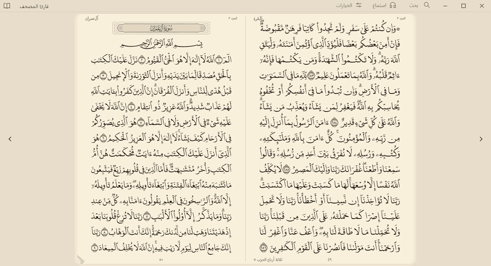
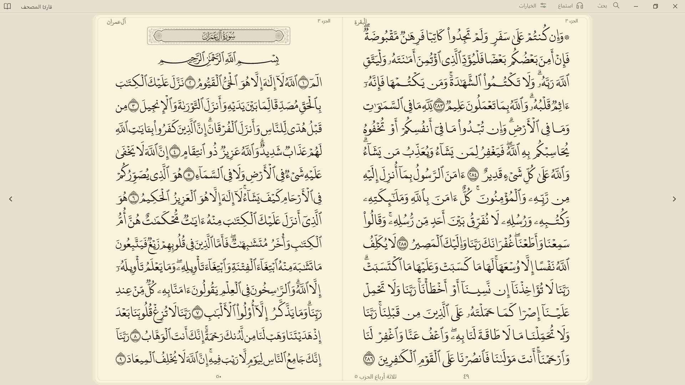
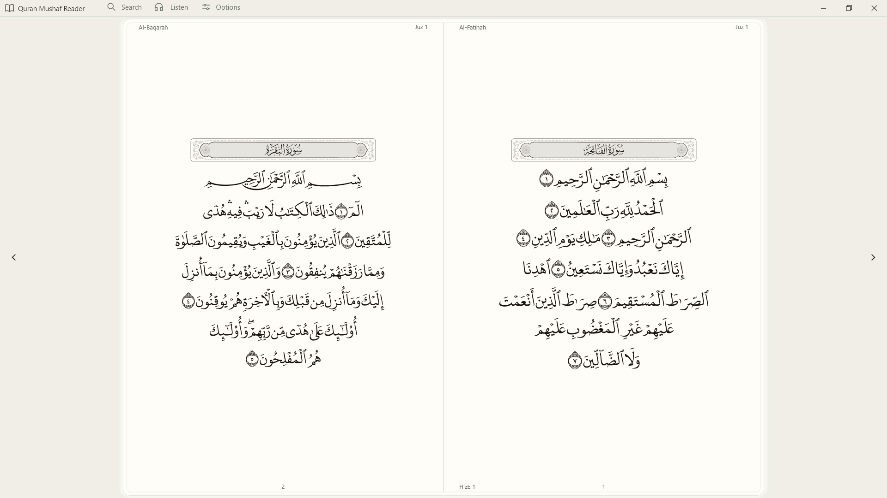
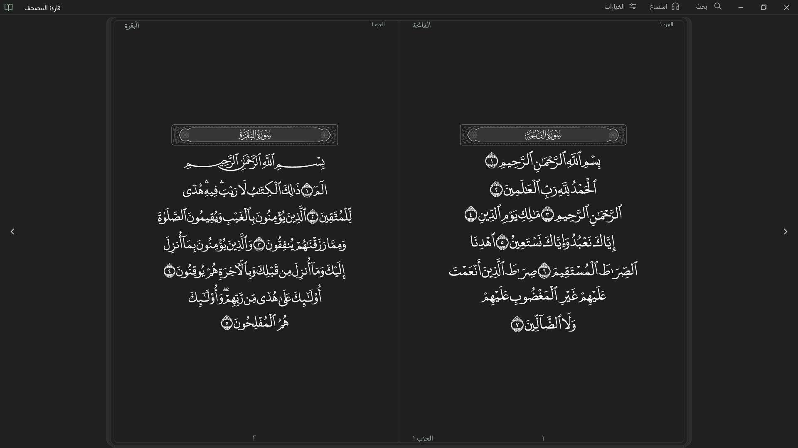
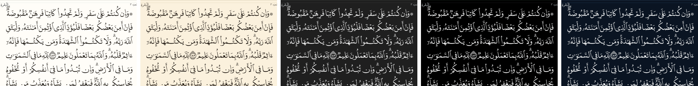
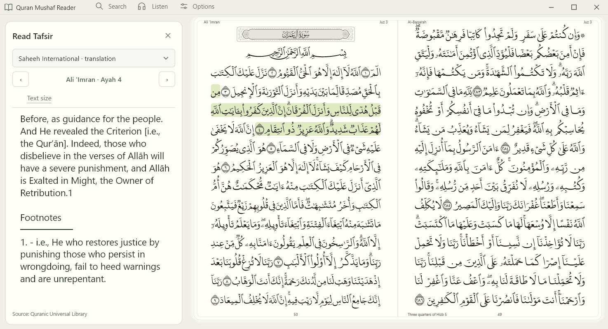
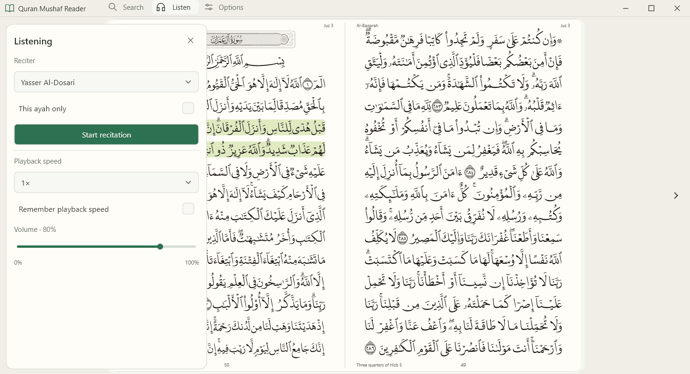
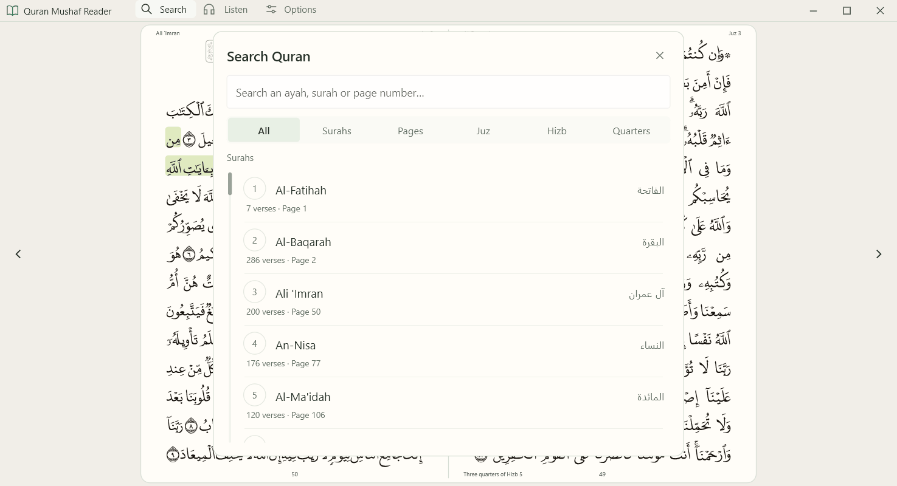

<div align="center">


# Quran Mushaf Reader

### قارئ المصحف

**A beautiful Mushaf for your Windows PC.**<br>
Full-window pages, sharp Arabic script, and page turns that feel like paper.<br>
Free and open source, with no account and no ads.

[](https://github.com/Thrpro/Quran-reader/releases)

[See it](#see-it) · [Features](#everything-you-need-nothing-in-the-way) · [Trust the text](#you-can-check-the-quran-text-yourself) · [Questions](#questions) · [Build it](#build-from-source)



<sub>Recorded from the app: one page dragged by its corner, then two turns with the arrow key.</sub>

</div>

<div dir="rtl">

**مصحف جميل لجهازك بنظام ويندوز.** صفحات تملأ النافذة، وخط عربي واضح بأي حجم، وتقليب للصفحات يشبه الورق، مع التفسير والتلاوة. مجاني ومفتوح المصدر، دون حساب أو إعلانات.

</div>

## Open it and read

Reading the Quran on a computer should feel calm. Too often the page ends up small in the middle of a large screen, surrounded by menus.

This app puts the Mushaf first. There is a slim title bar, and the rest of the window belongs to the page. Tafsir, recitation and search are one click away, and they leave when you're done.

| | |
|---|---|
| 📖 **The page comes first** | No permanent toolbars or bottom bar. The Mushaf fills as much of your window as it can. |
| ✒️ **Sharp at any size** | Pages are drawn for your exact window and display scale with [Digital Khatt](https://digitalkhatt.org), never stretched from an image. |
| 🍃 **Turns like paper** | Drag a page by its corner and it follows your hand, or tap an arrow key. Tap quickly and every turn is kept. |
| 🌙 **Comfortable day or night** | Five themes, from light and sepia to dark gray, pure black and navy night, in a full Arabic or English interface. |
| 🔒 **Yours to inspect** | No account and no ads. The code is open, and every bundled Quran file is listed with a checksum you can verify. |

## See it



<table>
<tr>
<td width="50%"></td>
<td width="50%"></td>
</tr>
<tr>
<td align="center"><sub>Light theme, English interface</sub></td>
<td align="center"><sub>Dark gray theme, Arabic interface</sub></td>
</tr>
</table>



<p align="center"><sub>Light · Sepia · Dark gray · Pure black · Navy night</sub></p>

### Study beside the page, not on top of it

Right-click any ayah to open its tafsir. The Mushaf moves over to make room, so the Quran text stays in full view with the ayah highlighted.



### Listen, and find anything

<table>
<tr>
<td width="50%"></td>
<td width="50%"></td>
</tr>
<tr>
<td align="center"><sub>Choose a reciter, speed and volume</sub></td>
<td align="center"><sub>Go to any ayah, surah, page, juz or hizb</sub></td>
</tr>
</table>

## Everything you need, nothing in the way

**Read**
- All 604 Mushaf pages, as a two-page spread or a single page
- Optional contextual lettering from Digital Khatt
- Full screen with <kbd>F11</kbd>, and bookmarks that stay between sessions
- The app reopens where you stopped

**Understand**
- Tafsir Al-Mukhtasar and Tafsir Al-Saadi in Arabic, and the Saheeh International translation in English
- All of it bundled, so it works with no internet connection
- Adjustable text size, with footnotes shown under the text

**Listen**
- Listen from any ayah to the end of its surah, or to a single ayah
- Choose your reciter, speed and volume, skip ten seconds, or seek
- The current ayah is highlighted on the page as it is recited

**Find**
- Search by text, surah, page, juz, hizb or quarter-hizb
- Arabic and Persian page digits both work

<details>
<summary><b>Keyboard shortcuts</b></summary>

| Action | Key |
|---|---|
| Turn the page | <kbd>←</kbd> <kbd>→</kbd> |
| Search | <kbd>Ctrl</kbd>+<kbd>F</kbd> |
| Listen | <kbd>Ctrl</kbd>+<kbd>L</kbd> |
| Options | <kbd>Ctrl</kbd>+<kbd>,</kbd> |
| Play or pause | <kbd>Ctrl</kbd>+<kbd>Space</kbd> |
| Full screen | <kbd>F11</kbd> |
| Close a panel, or leave full screen | <kbd>Esc</kbd> |

</details>

## You can check the Quran text yourself

This is the rule the rest of the project is built around: **interface work must never change the Quran.**

- **Sourced, not generated.** The text, page layout, fonts and study data come from the [Quranic Universal Library (QUL)](https://qul.tarteel.ai) by [Tarteel](https://www.tarteel.ai), and from [DigitalKhatt](https://digitalkhatt.org). None of it is AI-generated.
- **Kept apart from the code.** The app reads its Quran data from a separate resource pack and never regenerates, normalizes or substitutes it.
- **Checkable by anyone.** `resource-manifest.json` lists a SHA-256 hash for each of the 1,569 bundled files. Run this from the app folder, without launching the app:

  ```powershell
  ./Verify-Quran-Resources.ps1
  ```

**What this does and doesn't prove.** A match shows your files are byte-for-byte the ones this project packaged. It isn't a scholarly review, and a comparison of every file against an independently downloaded QUL release hasn't been completed yet, so the project doesn't claim one.

Found something that looks wrong in the text? Please [open an issue](https://github.com/Thrpro/Quran-reader/issues) with the page and line. These reports take priority over everything else.

## Get started

1. Download `QuranMushafReader-Setup-x64` from the latest [release](https://github.com/Thrpro/Quran-reader/releases).
2. Run it. It installs for your Windows account only, so it doesn't ask for administrator rights.
3. Open Quran Mushaf Reader from the Start menu. A short tour walks you through the app itself, lighting up each part as it explains it; you can see it again from **Options → Take the tour**.

Prefer not to install? Download the ZIP instead, extract it, and run `QuranMushaf.SlintReader.exe`.

You need 64-bit Windows 10 or 11. Nothing else needs to be installed, because the Visual C++ runtime files are included. So far, this version has only been tested on Windows 11.

Because the installer isn't code-signed yet, Windows may show "Windows protected your PC". Select **More info**, then **Run anyway**.

## Questions

<details>
<summary><b>Does it work offline?</b></summary>

Reading, search and all bundled tafsir work with no connection. Recitation streams when you ask for it. To listen offline, open <b>Options → Download manager</b> (or press Ctrl+D) and download a surah with your chosen reciter first; downloads are listed there with their size and can be deleted.
</details>

<details>
<summary><b>Does it cost anything, or collect my data?</b></summary>

It's free, with no account, no ads and no analytics. The only servers it contacts are the recitation providers, and only when you ask to listen.
</details>

<details>
<summary><b>Will it slow down my PC?</b></summary>

It's built in native Rust rather than a browser engine. It takes about 90 MB of disk space, and on the test PC it used about 230 MiB of memory after 60 page turns, with idle CPU under 0.1%. <a href="#small-and-light-measured">See how this was measured</a>.
</details>

<details>
<summary><b>Page turns look wrong on my PC. What can I do?</b></summary>

Start the app with <code>--renderer software</code> (for example, add it to the end of the shortcut's Target). It draws without the graphics card, which avoids most driver problems but makes page turns less smooth, then please <a href="https://github.com/Thrpro/Quran-reader/issues">tell us about your graphics card</a> so we can fix it.
</details>

## Small and light, measured

| | Native (this version) | Previous WebView2 version |
|---|---:|---:|
| Application and Quran resources on disk | **about 90 MB** | about 61 MB, plus the shared WebView2 runtime |
| Memory at idle after page turns, standard text | **230 MiB** | 506 MiB |
| Memory at idle after page turns, contextual lettering | **311 MiB** | 713 MiB |
| CPU while idle | **under 0.1%** | not measured |

<details>
<summary>How these were measured</summary>

Working-set memory on Windows 11 with a Ryzen 7 7735HS, in a maximized 1920×1080 window.

- **Native, standard text:** 60 spread turns, measured after 10 seconds of idle.
- **Native, contextual lettering:** 240 spread turns, measured after 10 seconds of idle. Memory was still rising slowly at the end of the run, by about 0.1 MiB per turn. Peak working set was 341 MiB.
- **Native renderer:** GPU, which is the default. Page turns ran at up to 144 Hz on the display tested. With software rendering (`--renderer software`), the same two runs on an earlier build measured 98 MiB and 187 MiB, with less smooth page turns.
- **WebView2 version:** 60 spread turns, measured after 15 seconds of idle, in headless Microsoft Edge rather than the installed WebView2 host. See [MEMORY-PERFORMANCE.md](MEMORY-PERFORMANCE.md).

The two procedures differ, so treat this as a comparison of scale rather than an exact ratio. Your numbers will vary by hardware and window size.

</details>

## Project status

The native version is a **preview**. It is close to the earlier WebView2 reader but does not yet match it everywhere.

Still in progress:
- Page-turn animations on very large windows, such as maximized on a 4K display
- Screen-reader and accessibility testing
- Testing across more GPUs, displays and mixed-DPI setups

## Build from source

You need Rust 1.92 or newer and the Windows x64 MSVC linker and SDK.

```powershell
cd experiments/slint-reader
cargo build --release --locked --target x86_64-pc-windows-msvc
```

The Quran resources are not built by this step. Use the `Resources` folder from a release download, which is covered by its `resource-manifest.json`:

```powershell
target\x86_64-pc-windows-msvc\release\quran-slint-reader-prototype.exe --resources C:\path\to\Resources
```

<details>
<summary>How it works</summary>

Quran pages are drawn by native **DirectWrite and Direct2D** code in Rust, which also produces the map of where each ayah sits on the page. **[Slint](https://slint.dev)** draws the interface around those pages and never shapes the Quran glyphs itself. A background worker prepares neighbouring pages ahead of time, within a fixed memory limit.

The earlier WebView2 reader is still in this repository, at the root and in `windows/QuranMushaf.Rust`. [SOURCE-RELEASE.md](SOURCE-RELEASE.md) explains how to build it.

</details>

## Help improve it

Bug reports, and help with accuracy, accessibility, usability and study features, are all welcome. Please open an issue before starting anything large.

Proposed changes to Quran text or source data must cite authoritative sources and be carefully verified. Rendering and interface changes must never alter the underlying text.

## Credits and license

With thanks to the teams behind [Quranic Universal Library](https://qul.tarteel.ai), [DigitalKhatt](https://digitalkhatt.org) and the open-source components this app uses. Full notices are in [THIRD-PARTY-NOTICES.md](THIRD-PARTY-NOTICES.md).

This project was developed with substantial help from AI coding tools for the application software and interface. The Quran content is not AI-generated, as described above.

The **application code** is under the [MIT License](LICENSE). This doesn't relicense the bundled Quran text, fonts, translations, tafsir or other third-party material, which stay under their providers' terms. The interface uses [Slint](https://slint.dev) under its royalty-free license.

[](https://slint.dev)

You're free to build on this code. If you distribute a modified version, please identify it as unofficial, so that readers always know which builds carry this project's integrity checks.

<div align="center">
<br>

*Developed with the intention of serving the Book of Allah and making it easier to read, for everyone.*

</div>
